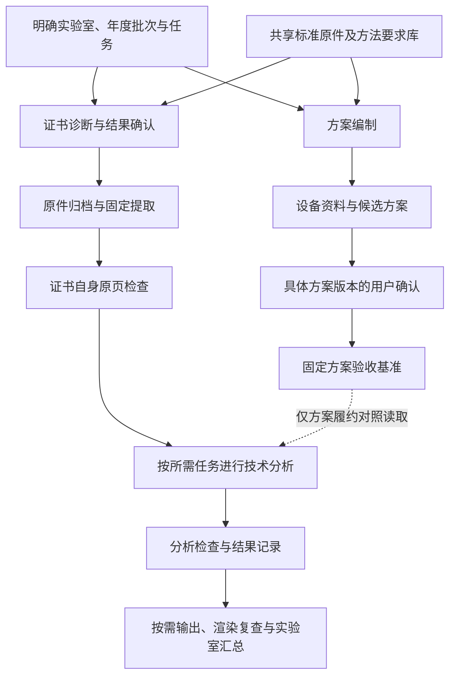

# 当前工作流程

本页是聊天执行和日常维护的流程总览。技术细节分别以确认表、U评价、PDF批注和存储契约为准；早期阶段设计用于追查建设背景。程序检查核对声明、引用及计算，智能体负责原页含义、依据适用性和技术判断，人员签署及批准由实验室完成。

## 多实验室上下文（2026-11-10）

开始方案或确认任务前，调用`context show --lab LAB --equipment-key KEY`汇集本实验室的标准采用、设备台账、实际用途、明确测量分工和有据选择。`KEY`用有身份依据的设备键，不从名称相似或共用证书推断；没有身份键时先完成原件识别。用途继续通过`method use-import`管理，实际配置继续由设备台账管理，不从历史确认结论反推事实。

用途可选measurement记录role、quantity、component、channel、direction、range_text和related_equipment_keys。同一设备多个用途分别关联方法要求；跨设备分工只读取明确关联的设备，候选用途单列。decision_rule及communication_workbook上下文说明经`context note-import`按实验室保存，修改用supersedes追加版本；有据选择仍须核清适用范围，不能自动成为其他项目或实验室的默认判据。

正式任务`confirmation prepare --equipment-key KEY`固定business-context.json及摘要；coverage原有条目用use_ids逐一说明已知实际用途的处理去向。程序只查关联和遗漏，不代替条款解释或原页语义核验。fresh-review仍不读取历史确认结论，但可读取原始用途、用户明确条件及设备台账。

上下文questions是实际公式输入和明确关联缺口的提示，不是必须逐条问用户的清单。智能体先查现有资料，只就改变本次结论且无法自行确定的事实集中询问；已明确内容复用，无独立限值的特性按既有中性记录规则处理。

## 变更、交付和问题处理（2026-11-10）

`confirmation impact --lab LAB`默认检查当前确认版本；--task定位某份，--history查历史。已固定上下文的任务比较实际用途、明确协作设备、台账配置、适用标准采用、实验室技术配置、表式和有据选择；候选意见及无关设备变化不改变当前依赖。旧任务没有上下文时显示“历史未固定业务上下文”，不自动要求全部重做，也不从旧结论重建实际事实。已校点范围与实际使用范围仍按既有技术判断规则处理。

新确认若明确替代更正前的证书，用prepare的--replaces-task和--replacement-reason记录同一设备的直接身份依据。只有同一明确设备、同批次的显式替代关系影响当前汇总；跨年记录及其他证书保留。不从同名、相近型号或文件日期自动认定替代。

有定位处理项时继续用既有B3适配层生成副本，finish同时传--annotations和--annotation-manifest。批注清单声明confirmation_task、source_hash、output、output_hash；可同时提供document_hash及self_run_id强化对应检查。兼容历史pdf/pdf_hash字段。finish在同一输出目录固定Word、结果、业务上下文及适用批注，写delivery-manifest.json并登记摘要；核验会检查各交付物。无定位处理项不生成空PDF。Excel是跨设备聚合输出，通过确认任务和交付清单关联，不在每份确认包中复制另一份可编辑主表。

问题处理用confirmation followup-import及followups。每条关联确认任务和issue_id，category区分更正、澄清、补校、使用条件；state为open、response_received或addressed。追加进展以supersedes保留历史，回复原件通过response_source_ids绑定；addressed须关联同一明确设备的新确认任务resolution_task。回复及处理完成记录不改写原技术结论，新证据仍按确认流程评价。更正证书可作为回复原件关联，不能直接把机构回复当作设备合格。

汇总增加“变更与跟进”，当前设备记录提供交付清单位置。用户指定的机构沟通工作簿沿用各实验室已有选择；这里的跟进记录不自动改写用户主表、不发送消息，也不成为限值来源。

## 入口与两条业务线路

聊天为主要入口，`./labcal`为统一程序入口；已有HTML继续使用相同应用服务。

方案编制写候选方案、新修订和确认基准；证书线路写提取、诊断和结果确认记录。证书结果不反向修改方案、方法原文或验收限值。方法用途评价不依赖已经确认的校准方案；方案履约对照必须有有效确认基准。

## 按任务选择执行路径

| 用户要做什么 | 使用入口 | 必要输入与输出 |
| --- | --- | --- |
| 检查证书本身 | `self-diagnosis` | 固定证书提取、逐页证据；输出自身诊断，有定位问题时输出B3副本 |
| 判断是否满足检测方法用途，不填正式表 | `method-diagnosis` | 明确采用方法、设备用途和条件；先完成自身检查，输出逐项方法对照 |
| 正式校准/检定结果确认 | `confirmation` | 固定实验室模板、证书、用途和方法范围；完成自身检查与技术分析，交付Word及汇总 |
| 对照已确认校准方案 | `review` | 固定有效基准与证书；输出方案履约对照，不拿候选方案作验收依据 |
| 编制或调整校准方案 | `plan`及方案接入入口 | 方法要求只读引用，形成候选版本；用户确认与设备配置分别保存 |

正式确认直接在CONF任务中完成方法覆盖与技术分析，无需为了凑齐步骤再重复创建一份METH诊断。仅需方法对照时也不强制生成Word。`method-diagnosis prepare`已有SELF任务时使用该任务，不再重复prepare同一份自身检查。

已有自身检查可在证书原件、提取版本和实际核查范围一致时明确引用；新证据、提取或问题变化后核对有效性。用户要求独立重审时使用`--fresh-review`和原件，不以历史确认表作技术依据。

## 正式确认的执行顺序

1. **固定输入**：明确LAB、CAM、设备身份、证书版本、模板版本、实际用途及适用方法；原件入objects，任务引用摘要，不另复制一套可编辑事实。
2. **检查证书**：逐页清点已有项目、工况、点位、实测量、U和溯源；错误、疑点、未检查、缺资料分别记录。校准和检定各按适用规则处理。
3. **核清要求**：同时检索方法的设备、尺寸、操作、计算、图表和注释；区分适用验收要求、器具技术参考和特性记录。用途、标准版本及实际条件不能相互代替。
4. **完成判断链**：实际用途 → 原文要求及含义 → 对应实测量 → 适用判据 → U作用 → 分项及总体结论。先同单位复算，再检查结论是否超出证据范围。
5. **执行analyze**：使用同一份`confirmation-record.v1`检查原件引用、覆盖、要求类型、依据角色、判断链、U复算和结果选择。有阻断先处理，不用改措辞或自动限用绕过。
6. **形成正式输出**：从本实验室模板填写Word，五列正文与分析记录一致；`format`另存三维分色副本，渲染查看每页。需要的B3副本调用现有PDF适配层，原件保留。
7. **登记与交付**：`finish`重跑相同检查，固定Word、记录与来源摘要；同步本实验室诊断Excel并检查一致性。批量处理可用`--no-summary`逐份完成后统一汇总。出现`summary_pending`不能报告全部交付完成。

`analyze`、`format`、`finish`共享检查函数，不另维护“已通过”开关。既有版本字段用于历史兼容，不为本次整理新增版本、数据库或审批步骤。

正式表首先处理证书已有项目；证书外缺项、补校建议及整机完整性另列。用途覆盖清单在内部保留，必要证据进入正式表。校准点与日常工作点不重合不自动否定用途；评价范围与设备使用限制分别处理。

## 三类结论与U

| 维度 | 评价对象 | 不能代替的判断 |
| --- | --- | --- |
| 蓝色：证书自身 | 身份、表达、计算、证据及结论一致性 | 证书无明显错误不等于设备满足用途 |
| 紫色：器具技术要求 | 适用器具指标或明确声明的性能参考 | 参考比较通过不直接成为用途符合 |
| 橙色：检测用途 | 方法要求及设备实际承担的测量任务 | 用途符合不覆盖法定或明确适用的器具不满足项 |

分度/读数、MPE、重复性标准偏差、极差及U分别识别。U按同一测量量、点位、条件和单位评价；方法用途与器具参考分别列明依据和数值。采用JJF 1094时按适用分支执行；补充计算不得暗改正式判定规则。具体条款和边界只在[U评价规则](uncertainty-decision-rules.md)维护，本页不另抄一套判据。

## 数据和输出的责任

| 内容 | 在用位置 | 维护原则 |
| --- | --- | --- |
| 标准原件及共用要求 | `data/references` | 原文与拆解版本固定，各实验室只读复用 |
| 实验室采用、用途、证书和任务 | `data/laboratories/LAB_ID/lab.sqlite`及固定任务记录 | 明确实验室及批次；来源事实、判断和输出引用各有职责 |
| 接收暂存 | `inputs/CAM_ID/<线路>` | 成功归档后的可信字节由objects及摘要管理 |
| 原件 | `objects` | 不覆盖，不随年度复制成另一可编辑来源 |
| 工作稿、原页图和计算 | `processing/<线路>/TASK_ID` | 只存本任务所需材料，不作为第二个限值库 |
| 正式Word、PDF和诊断版本 | `outputs/certificates` | 固定版本及来源；不反向读取成当前验收限值 |
| 当前实验室诊断汇总 | `outputs/summaries/设备校准诊断汇总.xlsx` | 从固定结果生成，外部修改受保护，历史导出保留 |
| 用户既有机构沟通表 | 本实验室明确指定的工作簿 | 持续追加；与系统诊断投影区别管理，不作为限值事实库 |

汇总按“实验室／批次／证书／已明确的设备标识”选择最新版本，证书的不同提取版本归同一证书。当前兼容数据使用明确的设备显示标签；同一设备的别名须依据既有身份及用户证据归一，并保留变更记录。不同证书即使同名也分别保留，同一证书包含多台设备时也不合并；不能仅因共用证书或名称相似推断同一设备。历史记录和原件均不因此删除。

工作稿仅在正式输出已验证、来源引用完整且有清理记录时按既有授权清理。原件、已登记固定版本和历史输出不作通用自动删除。详细路径及备份见[文件存储契约](storage-layout.md)。

## 维护时只改一处规则

- 业务编排在`application`，不在CLI、HTML各写一套技术判断。
- 固定输入与原页证据核对在应用层；方法依据和角色检查在`domain/confirmation_basis.py`，判断链在`confirmation_reasoning.py`，U复算在`confirmation_uncertainty.py`。
- JSON契约由程序定义，`./labcal schema`生成schemas；Word/Excel是同一记录的输出，摘录字段是可追查引用，不是第二份限值来源。
- 新规则先检查原文、适用性和已有模块，复用现有检查；不为每次讨论再加一层审批、状态机或独立工作流。
- 维护后运行相关测试及全套检查，用真实任务只读检查兼容性，不把工程验证登记成真实重新确认。

详细执行规则：[正式确认表](equipment-confirmation-forms.md)、[方法要求](method-requirements.md)、[证书自身诊断](chat-self-diagnosis.md)、[B3批注](report-annotations.md)、[架构](architecture.md)。周期、历史趋势和异常影响仍按原约定预留。
